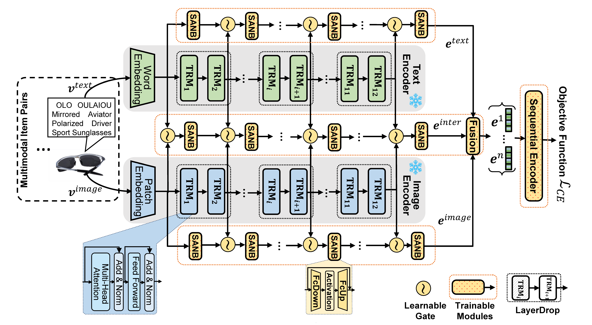
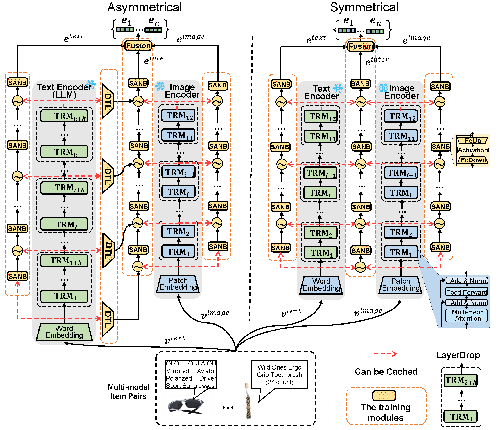
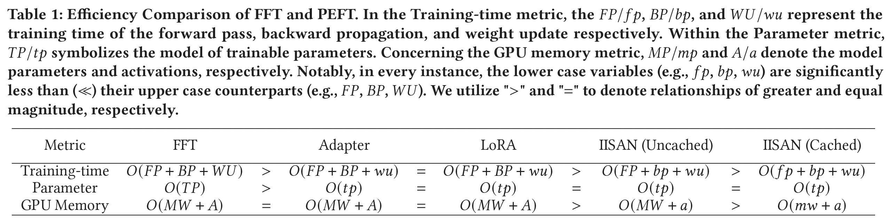
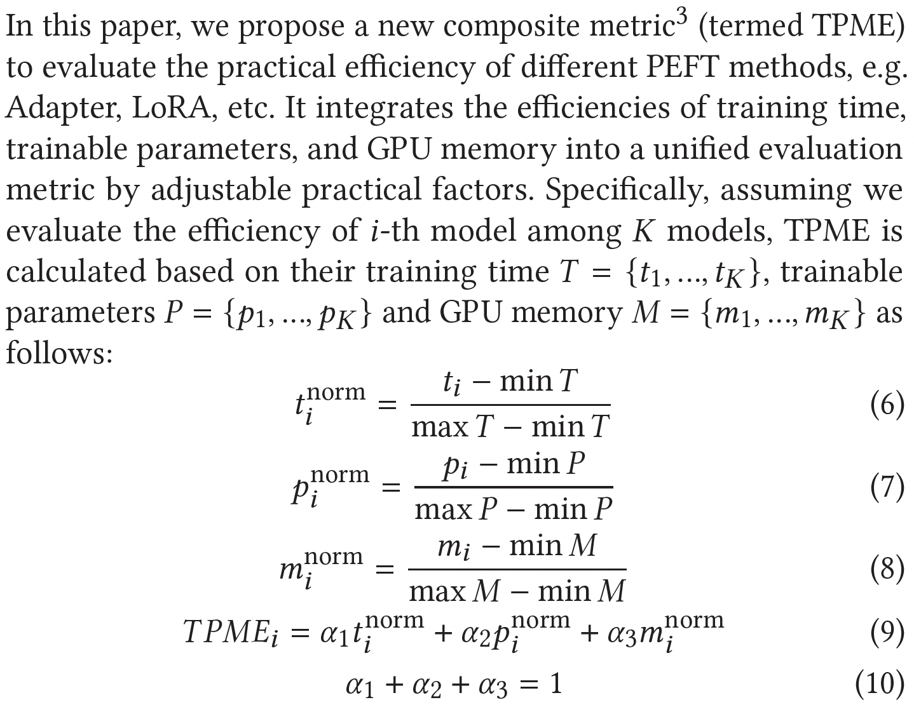

# [SIGIR2024] IISAN: Efficiently Adapting Multimodal Representation for Sequential Recommendation with Decoupled PEFT
 
 
 
<a href="https://arxiv.org/abs/2404.02059" alt="arXiv"></a>
<a href="https://mp.weixin.qq.com/s/fiCiPehSmDCM8ys3-xMwQg" alt="中文博客"></a> 
<a href="https://zhuanlan.zhihu.com/p/696297979" alt="知乎"></a> 

# [TKDE2025] Efficient and Effective Adaptation of Multimodal Foundation Models in Sequential Recommendation
 
 
 
 
<a href="https://arxiv.org/abs/2411.02992" alt="arXiv"></a>
<a href="https://mp.weixin.qq.com/s/xIjmGZ-nE5sr2D8c70DlxQ?scene=1" alt="中文博客"></a> 

If you are interested in adopting parameter-efficient fine-tuning (PEFT) in recommendation you can also refer to our previous WSDM 2024 paper: 
[Adapter4Rec](https://github.com/westlake-repl/Adapter4Rec)

## 🗞️ Latest News

- **[Feb 2026]** Added a reusable **Cursor / Claude Code prompt** — paste it into any AI coding assistant to instantly add IISAN adapters to your own dual-tower or single-tower frozen-model pipeline. See the [Cursor / Claude Code Reusable Prompt](#cursor--claude-code-reusable-prompt) section below.

### TODO list sorted by priority
* [x] Release the IISAN(Uncached)
* [x] Release baseline approaches
* [x] Release the IISAN(Cached)
--By April 30, 2024 (Completed early on April 15, 2024)
* [x] Release Datasets and IISAN(Cached)'s hidden states
* [x] Release the Implementation of IISAN-Versa --By October 15th, 2025

      

**If you encounter any questions or discover a bug within the paper or code, please do not hesitate to open an issue or submit a pull request.**

## IISAN Introduction
Multimodal foundation models are transformative in sequential recommender systems, leveraging powerful representation learning capabilities. While Parameter-efficient Fine-tuning (PEFT) is commonly used to adapt foundation models for recommendation tasks, most research prioritizes parameter efficiency, often overlooking critical factors like GPU memory efficiency and training speed. Addressing this gap, our paper introduces  IISAN (Intra- and Inter-modal Side Adapted Network for Multimodal Representation), a simple plug-and-play architecture using a Decoupled PEFT structure and exploiting both intra- and inter-modal adaptation. 

IISAN matches the performance of full fine-tuning (FFT) and state-of-the-art PEFT. More importantly, it significantly reduces GPU memory usage — from 47GB to just 3GB for multimodal sequential recommendation tasks.  Additionally, it accelerates training time per epoch from 443s to 22s compared to FFT. This is also a notable improvement over the Adapter and LoRA, which require 37-39 GB GPU memory and 350-380 seconds per epoch for training. 

Furthermore, we propose a new composite efficiency metric, TPME (Training-time, Parameter, and GPU Memory Efficiency) to alleviate the prevalent misconception that "parameter efficiency represents overall efficiency". TPME provides more comprehensive insights into practical efficiency comparisons between different methods. Besides, we give an accessible efficiency analysis of all PEFT and FFT approaches, which demonstrate the superiority of IISAN.

 


## IISAN-Versa Introduction
IISAN was limited to symmetrical MFMs and identical text and image encoders, preventing the use of state-of-the-art Large Language Models. To overcome this, we developed IISAN-Versa, a versatile plug-and-play architecture compatible with both symmetrical and asymmetrical MFMs. IISAN-Versa employs a Decoupled PEFT structure and utilizes both intra- and inter-modal adaptation. It effectively handles asymmetry through a simple yet effective combination of group layer-dropping and dimension transformation alignment. Our research demonstrates that IISAN-Versa effectively adapts large text encoders, and we further identify a scaling effect where larger encoders generally perform better. IISAN-Versa also demonstrates strong versatility in our defined multimodal scenarios, which include raw titles and captions generated from images and videos. Additionally, IISAN-Versa achieved state-of-the-art performance on the Microlens public benchmark. We will release our code and datasets to support future research.

 

---

## Cursor / Claude Code Reusable Prompt

> **For researchers who want to add IISAN adapters to their own pipeline:**  
> Copy the entire block below and paste it as context into **Cursor**, **Claude Code**, or any other AI coding assistant. The assistant will then be able to implement IISAN adapters alongside your existing frozen foundation models with no additional setup.

<details>
<summary><b>Click to expand — IISAN reusable prompt (copy & paste into Cursor / Claude Code)</b></summary>

````
# IISAN: Intra- and Inter-modal Side Adapter Network — Reusable Prompt

## What is IISAN?

IISAN is a **parameter-efficient adapter** that sits **beside** (not inside) frozen foundation models.
It taps selected intermediate hidden states from one or two frozen encoders, and processes them
through lightweight bottleneck adapters with learned gating.

**Three output branches**:
- **Intra-A**: adapter chain on Model A's hidden states → modality-A embedding
- **Intra-B**: adapter chain on Model B's hidden states → modality-B embedding
- **Inter (cross-modal)**: gated fusion of both hidden states → fused embedding

For **single-tower** use, only the Intra branch is needed.

---

## Pseudocode

```
# ── Dual-Tower IISAN (Asymmetric-safe) ────────────────────────
# Inputs:  h_A = [h_A_0, ..., h_A_K]   selected hidden states from frozen Model A
#          h_B = [h_B_0, ..., h_B_M]   selected hidden states from frozen Model B
#          K and M may differ (asymmetric)

state_A, state_B, state_mm = 0, 0, 0

# Phase 1: process the LONGER side's extra layers (intra only)
if M > K:
    for i in range(M - K):
        gate = sigmoid(gate_param_B[i] / tau)
        state_B = AdapterBlock_B[i](gate * h_B[i] + (1-gate) * state_B)
    offset_B, offset_A = M - K, 0
else:
    for i in range(K - M):
        gate = sigmoid(gate_param_A[i] / tau)
        state_A = AdapterBlock_A[i](gate * h_A[i] + (1-gate) * state_A)
    offset_A, offset_B = K - M, 0

# Phase 2: joint loop — intra + inter
L = min(K, M)
for i in range(L):
    # intra-A
    gate = sigmoid(gate_param_A[offset_A + i] / tau)
    state_A = AdapterBlock_A[offset_A + i](gate * h_A[offset_A + i] + (1-gate) * state_A)
    # intra-B
    gate = sigmoid(gate_param_B[offset_B + i] / tau)
    state_B = AdapterBlock_B[offset_B + i](gate * h_B[offset_B + i] + (1-gate) * state_B)
    # inter (cross-modal gated fusion)
    gate_mm = sigmoid(gate_param_mm[i] / tau)
    a_proj = project_A(h_A[offset_A + i]) if dim_A != dim_B else h_A[offset_A + i]
    b_proj = project_B(h_B[offset_B + i]) if dim_B != dim_A else h_B[offset_B + i]
    state_mm = AdapterBlock_mm[i](state_mm + gate_mm * a_proj + (1-gate_mm) * b_proj)

out_A  = fc_down_A(fc_A(state_A))      # → target_dim
out_B  = fc_down_B(fc_B(state_B))      # → target_dim
out_mm = fc_down_mm(fc_mm(state_mm))   # → target_dim

# ── Single-Tower Side Adapter ─────────────────────────────────
state = 0
for i in range(N):
    gate = sigmoid(gate_param[i] / tau)
    state = AdapterBlock[i](gate * h[i] + (1-gate) * state)
out = fc_down(fc(state))  # → target_dim
```

---

## Minimal PyTorch Implementation

```python
import torch
import torch.nn as nn


class AdapterBlock(nn.Module):
    """Bottleneck adapter: down-project → activation → up-project + residual."""
    def __init__(self, in_dim, down_dim, dropout=0.1, act="gelu"):
        super().__init__()
        self.down = nn.Linear(in_dim, down_dim)
        self.up   = nn.Linear(down_dim, in_dim)
        self.act  = nn.GELU() if act == "gelu" else nn.ReLU()
        self.drop = nn.Dropout(dropout)
        nn.init.normal_(self.down.weight, std=1e-2)
        nn.init.zeros_(self.down.bias)
        nn.init.normal_(self.up.weight, std=1e-2)
        nn.init.zeros_(self.up.bias)

    def forward(self, x):
        return self.up(self.act(self.down(x))) + x  # residual


class SideAdapter(nn.Module):
    """Single-tower side adapter. Minimal IISAN for ONE frozen encoder."""
    def __init__(self, in_dim, down_dim, out_dim, n_blocks, dropout=0.1, tau=0.1):
        super().__init__()
        self.tau = tau
        self.adapters = nn.ModuleList(
            [AdapterBlock(in_dim, down_dim, dropout) for _ in range(n_blocks)]
        )
        self.gates = nn.ParameterList(
            [nn.Parameter(torch.zeros(1)) for _ in range(n_blocks)]
        )
        self.fc   = nn.Linear(in_dim, in_dim)
        self.proj = nn.Linear(in_dim, out_dim)

    def forward(self, hidden_states: list) -> torch.Tensor:
        state = torch.zeros_like(hidden_states[0])
        for i, adapter in enumerate(self.adapters):
            gate = torch.sigmoid(self.gates[i] / self.tau)
            state = adapter(gate * hidden_states[i] + (1 - gate) * state)
        return self.proj(self.fc(state))


class IISAN(nn.Module):
    """Dual-tower IISAN with asymmetric support."""
    def __init__(self, dim_a, dim_b, down_a, down_b, out_dim,
                 n_a, n_b, dropout=0.1, tau=0.1):
        super().__init__()
        self.tau = tau
        self.n_a, self.n_b = n_a, n_b
        self.n_joint = min(n_a, n_b)

        self.adapters_a = nn.ModuleList([AdapterBlock(dim_a, down_a, dropout) for _ in range(n_a)])
        self.adapters_b = nn.ModuleList([AdapterBlock(dim_b, down_b, dropout) for _ in range(n_b)])
        self.gates_a = nn.ParameterList([nn.Parameter(torch.zeros(1)) for _ in range(n_a)])
        self.gates_b = nn.ParameterList([nn.Parameter(torch.zeros(1)) for _ in range(n_b)])

        mm_dim = min(dim_a, dim_b)
        self.adapters_mm = nn.ModuleList([AdapterBlock(mm_dim, min(down_a, down_b), dropout) for _ in range(self.n_joint)])
        self.gates_mm    = nn.ParameterList([nn.Parameter(torch.zeros(1)) for _ in range(self.n_joint)])

        self.proj_a_to_mm = nn.Linear(dim_a, mm_dim) if dim_a > mm_dim else nn.Identity()
        self.proj_b_to_mm = nn.Linear(dim_b, mm_dim) if dim_b > mm_dim else nn.Identity()

        self.fc_a    = nn.Linear(dim_a, dim_a)
        self.fc_b    = nn.Linear(dim_b, dim_b)
        self.fc_mm   = nn.Linear(mm_dim, mm_dim)
        self.proj_a  = nn.Linear(dim_a, out_dim)
        self.proj_b  = nn.Linear(dim_b, out_dim)
        self.proj_mm = nn.Linear(mm_dim, out_dim)

    def forward(self, h_a: list, h_b: list):
        state_a  = torch.zeros_like(h_a[0])
        state_b  = torch.zeros_like(h_b[0])
        state_mm = torch.zeros(h_a[0].size(0), self.adapters_mm[0].down.in_features, device=h_a[0].device)

        off_a, off_b = self.n_a - self.n_joint, self.n_b - self.n_joint

        for i in range(off_a):
            g = torch.sigmoid(self.gates_a[i] / self.tau)
            state_a = self.adapters_a[i](g * h_a[i] + (1 - g) * state_a)
        for i in range(off_b):
            g = torch.sigmoid(self.gates_b[i] / self.tau)
            state_b = self.adapters_b[i](g * h_b[i] + (1 - g) * state_b)

        for j in range(self.n_joint):
            ia, ib = off_a + j, off_b + j
            g_a = torch.sigmoid(self.gates_a[ia] / self.tau)
            state_a = self.adapters_a[ia](g_a * h_a[ia] + (1 - g_a) * state_a)
            g_b = torch.sigmoid(self.gates_b[ib] / self.tau)
            state_b = self.adapters_b[ib](g_b * h_b[ib] + (1 - g_b) * state_b)
            g_mm = torch.sigmoid(self.gates_mm[j] / self.tau)
            state_mm = self.adapters_mm[j](
                state_mm + g_mm * self.proj_a_to_mm(h_a[ia]) + (1 - g_mm) * self.proj_b_to_mm(h_b[ib])
            )

        return (
            self.proj_a(self.fc_a(state_a)),
            self.proj_b(self.fc_b(state_b)),
            self.proj_mm(self.fc_mm(state_mm)),
        )
```

---

## Quick-Start Integration Guide

### 1. Extract hidden states from your frozen model

```python
with torch.no_grad():
    outputs = frozen_model(inputs, output_hidden_states=True)
all_hidden = outputs.hidden_states           # tuple of (B, SeqLen, D)
selected   = [all_hidden[i][:, 0, :] for i in tap_layers]  # CLS token → list of [B, D]
```

### 2. Single-tower

```python
adapter = SideAdapter(in_dim=768, down_dim=64, out_dim=64, n_blocks=6)
emb = adapter(selected_hidden_states)  # [B, 64]
```

### 3. Dual-tower (asymmetric architectures supported)

```python
iisan = IISAN(dim_a=768, dim_b=4096, down_a=64, down_b=64,
              out_dim=64, n_a=6, n_b=6)
emb_v, emb_t, emb_fused = iisan(h_vision, h_text)
```

### 4. Freeze originals, train only IISAN

```python
for p in frozen_model.parameters():
    p.requires_grad = False
optimizer = torch.optim.Adam(iisan.parameters(), lr=1e-4)
```

---

## Key Hyperparameters

| Hyperparameter | What it controls | Typical range |
|---|---|---|
| `tap_layers` | Which frozen layers to read | Evenly spaced, e.g. `[1,3,5,7,9,11]` for a 12-layer model |
| `down_dim` | Bottleneck width | 16–128 (64 is a good default) |
| `tau` | Gating temperature | 0.1 (sharp) to 1.0 (soft) |
| `n_blocks` | Depth of side network | 4–8 usually sufficient |
````

</details>

---

## Experiment Setup
```
conda create -n iisan python=3.8

conda activate iisan

pip install torch==1.13.0 torchvision==0.14.0 torchaudio==0.13.0 loralib==0.1.1 transformers==4.20.1 lmdb pandas
```
## Preparation
The complete textual recommendation datasets are available under the Dataset directory. 

Download the image files:

"am_image_is.zip" for Scientific dataset from this [link](https://drive.google.com/file/d/1vXLls-2DvvkMfgiCv3nB8C29nu0NDdt3/view?usp=sharing)

"am_image_mi.zip" for Instruments dataset from this [link](https://drive.google.com/file/d/1icKbl3ltN28WDESSKOdhOA0pNWIiNxe0/view?usp=sharing)

"am_image_op.zip" for Office dataset from this [link](https://drive.google.com/file/d/1zl-RbSNwUmQicCB3w1xY9RQWN8vGg5pC/view?usp=sharing)

You should unzip these zip files under "Dataset/". Then run the following to get the lmdb files:
```
cd Dataset/
python build_lmdb.py
```
Download "pytorch_model.bin" of the vit-base-patch16-224 from this [link](https://huggingface.co/google/vit-base-patch16-224) and bert-base-uncased from this [link](https://huggingface.co/google-bert/bert-base-uncased). Then put them under the respective subfolder under "pretrained_models/".

## Training & Testing for IISAN(Uncached)
```
cd Code_Uncached/scripts/
python run_IISAN.py
```
## Training & Testing for IISAN(Cached) 
**Note: Theoretically, IISAN(Cached) will only improve the training efficiency and maintain the original performance of IISAN(Uncached).**
```
cd Code_Cached/
python preprocess_vectors.py

cd scripts/
python run_IISAN.py

```
## Training & Testing for IISAN-Versa (Asymmetrical) using Llama-3-70b
```
cd Code_Cached_Asym/
python preprocess_llama-3-70b.py

cd scripts/
python run_IISAN.py

```


## Efficiency Analysis
 

## New Efficiency Metric - TPME (Training-time, Parameter, GPU Memory Efficiency)
<p align="center" width="100%">

</p>

where $\alpha$ denotes the weighting assigned to each term, tailored to specific circumstances, for example, in scenarios where only a limited GPU capacity is available for model training, it's advisable to significantly augment the weight of $M$. Within the scope of this paper, we've adjusted the values of $\alpha_1$ and $\alpha_3$ to 0.45, and $\alpha_2$ to 0.1. This adjustment reflects our focus on two key practical aspects: training speed and memory efficiency.

## Citation
If you find our paper useful in your work, please cite our paper as:
```
@inproceedings{fu2024iisan,
  title={IISAN: Efficiently Adapting Multimodal Representation for Sequential Recommendation with Decoupled PEFT},
  author={Fu, Junchen and Ge, Xuri and Xin, Xin and Karatzoglou, Alexandros and Arapakis, Ioannis and Wang, Jie and Jose, Joemon M},
  booktitle={Proceedings of the 47th International ACM SIGIR Conference on Research and Development in Information Retrieval},
  pages={687--697},
  year={2024}
}
@article{fu2025efficient,
  title={Efficient and effective adaptation of multimodal foundation models in sequential recommendation},
  author={Fu, Junchen and Ge, Xuri and Xin, Xin and Karatzoglou, Alexandros and Arapakis, Ioannis and Zheng, Kaiwen and Ni, Yongxin and Joemon, Joemon M Jose},
  journal={IEEE Transactions on Knowledge and Data Engineering},
  year={2025},
  publisher={IEEE}
}
```


## Join the GAIR Lab at the University of Glasgow

Our [**GAIR Lab**](https://gair-lab.github.io/), specializing in **generative AI solutions for information retrieval tasks**, is actively seeking **highly motivated Ph.D. students** with a strong background in **artificial intelligence**.

If you're interested, please contact **Prof. Joemon Jose** at [joemon.jose@glasgow.ac.uk](mailto:joemon.jose@glasgow.ac.uk).


<p align="center" width="100%">

</p>
